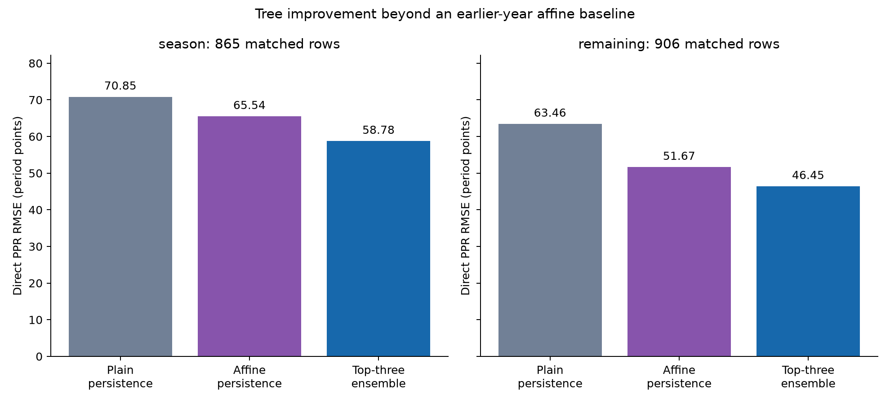

# Running back GPU research — October 3, 2026

This campaign implements optional NVIDIA-backed tree models and studies RB
production from the canonical raw snapshot. It does not use the prepared feature
matrix or an earlier feature-selection registry. The experiments and reusable
research models are separate from the application's serving policy.

The main run completed all **6,656 target/fold fits across 52 recipes** without
failures. The dimension and draft-capital studies add 1,024 and 256 target/fold fits.
The main ensembles lower PPR MSE versus affine persistence by **19.6% preseason**
and **19.2% after Week 2**; the draft extension further improves the fixed preseason
raw anchors. All figures describe historical development evidence.

## Reproduce and inspect

- [GPU environment and backend contract](../operations/gpu_research_setup.md)
- [Campaign protocol and commands](../../experiments/future_player_lab/gpu_lab/README.md)
- [Integrated local report](../../experiments/future_player_lab/runs/rb_gpu_20261003_001/index.html)
- [Named-player profile browser](../../experiments/future_player_lab/runs/rb_gpu_20261003_001/profiles/players/index.html)

The generated reports, data, and trained models live in ignored local run
directories. A fresh clone needs the documented shared-data restore and experiment
commands; this checked-in summary preserves the findings and their interpretation.
The raw snapshot manifest SHA-256 is
`f4595619cd7c261c006d31fd6b5cfd871bdd9fbc01daffa2e533766f1203613f`.

## Population and protocol

The main input contains 4,810 raw-derived numeric fields across 3,843 preseason
and 4,078 after-Week-2 player-season rows, covering 2002–2025. Histories include
box scores, play-by-play, team context, availability, tracking summaries, college,
combine, and calendar context. Preseason candidates are prior-year RB participants
plus drafted combine entrants with exact identity links; in-season candidates also
include players observed by the forecast cutoff. Players are not filtered by
their future participation. This population includes low-usage and zero-production
outcomes and has incomplete coverage of newcomers, especially undrafted entrants.

The main matrix omits draft capital: the combine loader explicitly excluded draft
fields, and mixed roster schemas promoted draft pick to text before numeric-field
extraction. A separate controlled study preserves all original inputs and appends
three known-as-of fields: overall pick, round, and years since draft. Missing values
remain unknown rather than being labeled undrafted. This gap and its separate
4,813-field extension are retained in the provenance instead of rewriting the
frozen campaign after seeing results.

All predictive preprocessing fits earlier years only. Known publication delays,
future outcomes, closing lines, and sources without usable identity/time contracts
are excluded. Missing recorded outcomes remain unknown separately for each stat;
absence of production in a known completed period is zero. Historical provider
revisions and last-observed team assignment still limit point-in-time realism.

The frozen 52-recipe search crosses four engines with eight unsupervised input
representations and adds CPU controls, eight seeded hyperparameter/history variants,
eight source ablations, and two opportunity-times-efficiency challengers. Engines
include XGBoost CUDA, CatBoost GPU, NVIDIA RAPIDS cuML random forests, LightGBM,
histogram boosting, and extra trees. Predictions cover carries, rushing yards,
rushing touchdowns, targets, receptions, receiving yards, receiving touchdowns,
and rushing/receiving PPR points.

The 2018–2020 forecasts initialize validation; 2021–2025 provide five chronological
evaluation years. Each year's recipe and ensemble choices use only the preceding
three years. Equal top-three, different-family, and convex-weight ensembles are
evaluated alongside single-model selection. PPR is 0.1 × rushing/receiving yards +
receptions + 6 × rushing/receiving touchdowns; it excludes fumbles, passing,
returns, conversions, and league bonuses.

Top-three selection counts recipes. For carries, targets, and direct PPR, the
factorized recipes duplicate the direct specifications of their raw/correlation
anchors, so this policy may contain fewer than three distinct specifications.
The different-family policies enforce distinct engines; all policies remain
unchanged after evaluation.

## Preseason prediction

The equal top-three tree ensemble has the following pooled 2021–2025 errors on
865 player-seasons. The affine baseline learns regression to the mean from earlier
data using only the persistence forecast. Its expanding/recent-three-year variant
is also selected using earlier validation years.

| Target | Plain persistence RMSE | Affine persistence RMSE | Tree RMSE | Tree MSE improvement over affine |
| --- | ---: | ---: | ---: | ---: |
| PPR points | 70.85 | 65.54 | 58.78 | 19.6% |
| Rushing yards | 312.09 | 287.68 | 262.04 | 17.0% |
| Receptions | 15.32 | 13.89 | 12.57 | 18.2% |
| Receiving yards | 121.96 | 110.43 | 101.84 | 14.9% |

Compare methods within each horizon; their target periods differ. Evaluation uses
2021–2025. The figure describes the main policies before the draft-capital extension.
[SVG](assets/rb_gpu_campaign_2026-10-03.svg) ·
[PDF](assets/rb_gpu_campaign_2026-10-03.pdf) ·
[Values](assets/rb_gpu_campaign_2026-10-03.csv) ·
[Provenance](assets/rb_gpu_campaign_2026-10-03_provenance.json)

Trees beat affine persistence on all eight targets in each of the five evaluation
years. PPR squared-error improvement over plain persistence is 31.2%; the stronger
baseline explains part of that gain. High-prior-usage PPR improves 17.4% over affine
in aggregate, although its 2025 subgroup is 3.4% worse. Aggregate improvement does
not imply every player, year, or error metric improves.

## Remaining season after Week 2

The same prespecified top-three policy improves all eight targets over affine
persistence in every evaluation year, on 906 player-seasons. Regression to the
mean explains a substantial part of the improvement over simply extrapolating two
games, but the richer inputs still add predictive value.

| Target | Plain persistence RMSE | Affine persistence RMSE | Tree RMSE | Tree MSE improvement over affine |
| --- | ---: | ---: | ---: | ---: |
| PPR points | 63.46 | 51.67 | 46.45 | 19.2% |
| Rushing yards | 275.38 | 223.60 | 203.56 | 17.1% |
| Receptions | 15.76 | 11.33 | 10.08 | 20.8% |
| Receiving yards | 138.70 | 94.83 | 82.24 | 24.8% |

The different-family ensemble is marginally better on remaining PPR (RMSE 46.19,
20.1% lower MSE than affine). Ensemble differences are small and no policy wins
every target. High-prior-usage PPR improves 22.7% over affine in aggregate, but its
2023 subgroup worsens by 18.4%; four of five years improve in that smaller cohort.

The top-three PPR residual distribution has CRPS 21.10 versus 23.62 for the
residual-calibrated persistence distribution. Its nominal 80% interval covers
78.8% of observations, with mean width 83.3 points. Preseason coverage is 84.7%,
with width 124.8. This residual-distribution comparison is distinct from the affine
point-forecast baseline; no affine predictive intervals were fitted.

Independent stat forecasts are not always mutually consistent. The top-three
policy predicts more receptions than targets for 8.55% of preseason and 8.72% of
remaining-season rows; the observed labels have no such violations. Direct PPR
and the sum of component means differ by 4.82 and 3.59 points on average in absolute
value. These outputs were measured without post-hoc repair. A coherent joint or
constrained stat model is a concrete follow-up, not an established improvement in
this campaign.

## Representations and player profiles

Preseason raw inputs plus 48 PCA components modestly improve the fixed raw PPR
anchor in all four tested engines (0.08–0.75% lower MSE). Replacing the original
inputs with 48 ordinary PCA components worsens PPR MSE by 20.7–27.9%; SVD and random
projection are worse still. Correlation filtering is close to neutral. These
controlled results support retaining original information; they do not establish
a universally best representation or prove that dimensionality reduction never
helps.

After Week 2, correlation filtering improves PPR MSE by 0.005–1.25% across the four
fixed engines. Adding PCA to raw inputs is mixed (0.92% worse to 0.29% better), while
48-component ordinary PCA alone is 20.0–32.8% worse. Small differences between the
raw-preserving methods should not be treated as robust universal advantages.

The separate 1,024-fit XGBoost dimension study tests 16 and 128 components alongside
the verified 48-component and raw controls. No tested projection-only setting
beats raw PPR at either horizon. At 128 components, ordinary PCA still has 24.0%
higher preseason MSE and 23.7% higher remaining-season MSE. Larger SVD and random
projections partly recover lost accuracy; source-balanced PCA is not monotonic in
component count. This strengthens the finding for this fixed tree anchor while
leaving other configurations and representation designs open.

Full-data k-means and Gaussian-mixture profiles support descriptive player
comparison. Their all-year memberships must not be treated as forecast-time
features. Separate chronological profile fits evaluate predictability within
groups. Source-balanced profiles frequently separate historical eras or data
coverage rather than distinct contemporary roles; their held-out groups can
collapse to one or two occupied clusters.

Profile-only preseason PPR forecasts are weaker than persistence: the descriptively
best tested soft Gaussian-mixture recipe has RMSE 81.25 versus 70.85. Its
after-Week-2 RMSE is 60.21 versus 63.46, but only three of five years improve and the
season-bootstrap MSE-difference interval crosses zero. Descriptive interpretability
alone does not establish predictive value.

The stronger affine control changes that profile comparison materially: even this
descriptively best standalone PPR profile recipe has 53.7% higher preseason MSE and
35.8% higher remaining-season MSE than affine persistence on identical rows. Its
gain over plain remaining-season persistence therefore does not demonstrate
superiority over simple shrinkage.

Conditional uncertainty is uneven. Although overall remaining-season PPR coverage
is 78.8% for the nominal 80% interval, annual standard-k-means groups with at least
20 players range from 65.2% to 93.0%. These are small, exploratory group comparisons;
the profile method does not guarantee reliable uncertainty for each player type.

## Which inputs carry signal?

In the held-out 2025 selected-model diagnostics, jointly perturbing box-score
histories and historical production totals causes the largest error increases
for PPR, rushing yards, and receiving yards. Age/calendar and roster context have
smaller contributions; relationships depend on target, horizon, selected model,
and which redundant inputs remain. These diagnostics cover one evaluation year
and three permutations per source, not a universal feature ranking.

Some highly ranked native features are missingness flags, including indicators
for fields such as `current__pbp_rush__field_goal_attempt`. Such flags can describe
whether a rushing record exists or whether a source covers the player. Their names
do not establish that field-goal ability predicts RB production. Source permutation,
controlled ablation, and individual training importance answer different questions;
their contributions are not additive explained variance.

For the fixed XGBoost anchor, removing extended history increases PPR MSE by 2.17%
preseason and 3.55% after Week 2. A box-score-only view is close to the full input
at both horizons. Removing provider-derived fields reduces PPR MSE by 1.01% and
4.63%, respectively. These finite comparisons suggest substantial redundancy;
they do not prove that advanced NFL metrics are useless. College/combine and
availability removals slightly worsen both horizons, before the separate draft
extension is considered.

Opportunity-times-efficiency models do not clearly improve the tested direct
rushing-yard or reception forecasts. The raw factorized challenger is slightly
better after Week 2 for rushing yards/receptions (0.21%/0.12% MSE), but worse for
receiving yards (2.09%) and all three preseason targets. Multiplying predicted
volume by predicted efficiency is an approximation to a conditional mean, not an
automatic statistical improvement.

## Draft-capital extension

The separate study completes 256 target/fold fits and 32 final refits with the
original 4,810 values preserved and three draft-event fields appended. Relative
to the same raw anchor without those fields:

| Horizon | Anchor | PPR RMSE with draft fields | Raw anchor RMSE | MSE reduction |
| --- | --- | ---: | ---: | ---: |
| Preseason | XGBoost | 57.59 | 59.16 | 5.24% |
| Preseason | LightGBM | 58.04 | 59.12 | 3.64% |
| After Week 2 | XGBoost | 46.44 | 46.51 | 0.32% |
| After Week 2 | LightGBM | 46.61 | 46.78 | 0.73% |

Both preseason anchors improve in four of five evaluation years. Among the 89
included dated drafted entrants, preseason PPR MSE improves by 20.66% for XGBoost
and 25.15% for LightGBM; three of five years improve in that smaller cohort.
After Week 2 the aggregate gains are small and less stable:
three years improve for XGBoost and two for LightGBM. The remaining-season
known-current-draft-year cohort includes 92 rows, including rookies already observed
in Weeks 1–2; it differs from the 25 unobserved drafted-entrant rows.

The draft-augmented preseason XGBoost anchor also has lower pooled error than the
main top-three ensemble, but this is a separate gap-driven development comparison.
The full 52-recipe search was not rerun with the added fields, and its original
policies were not retrospectively changed. The extension provides its own saved
models, source/time audit, matched comparisons, and successful pipeline-replay
audit. It supports carrying known draft information into the next experiment;
missing draft metadata is not evidence that a player was undrafted.

## Play-level context

A separate Big Data Bowl 2020 experiment predicts RB rushing yards from context at
handoff: 2017 trains, 2018 tunes/calibrates, and the available partial 2019 season
evaluates. It contains 28,886 RB carries and 21 verified CUDA fits. All-player
motion/spatial context lowers RMSE from a constant baseline's 6.448 to 6.366 on
7,273 evaluation plays, a 2.5% MSE reduction. CRPS improves from 2.723 to 2.689.
Game-block paired uncertainty supports a small improvement in this sample.

This is a different prediction task from season production. Retrospective handoff
annotations, weather publication, tracking orientation, a partial evaluation year,
and the absence of a validated cross-release player join limit transfer claims.
The [play-context readout](../../experiments/future_player_lab/runs/rb_gpu_play_context_20261003_001/readout.md)
retains its source and model provenance.

## Interpretation limits

NVIDIA cuML is an available and verified backend, not an accuracy guarantee. The
representative 160-tree XGBoost benchmark took 1.41 seconds on CUDA versus 2.05
seconds with four CPU threads on this RTX 4090 machine. cuML's four-stream forest
was 2.31 times faster than its one-stream configuration, with identical predictions
in three fixture repeats. Another GPU workload was active, and these timings do
not generalize to every representation, target, or machine.

2025 was examined in earlier repository research, and the affine and draft-capital
checks were added after the completed preseason preview. These are historical
development results, not an untouched prospective test. Season-block intervals
describe variation across five years and omit other uncertainty from shared
players, overlapping training histories, and model-development choices.

Permutation importance, native importance, and source-removal comparisons describe
predictive associations and redundancy. They do not identify causal player talent
or establish that a source is universally unnecessary. Marginal residual intervals
are evaluated for coverage and CRPS; independently forecast component means do
not create a coherent joint distribution automatically.

## Verification and retained artifacts

All 898 distinct application/research tests pass, with no failures, errors, or
skips. Ruff and whitespace checks pass. The main audit verifies all 832 fold
checkpoints, 1,155,232 candidate forecast rows, source/configuration hashes, earlier
training cutoffs, finite forecasts, and actual CUDA execution. There are 6,816
native estimator fits within the 6,656 target pipelines because factorized models
have separate volume and efficiency components.

The final main library retains 70 fitted member pipelines and 64 policy records,
trained through 2025. Supplementary audits independently reproduce all 384
dimension comparisons, replay saved main policy predictions with reordered input
columns, and replay the dimension/draft pipelines. Draft evaluation and final-refit
checkpoints are audited separately. These are integrity checks, not prospective
validation.

The integrated report retains 23 CSV exports, four PNG/SVG/PDF figure sets, the
underlying forecast tables, source snapshots, and model artifacts. Its manifest
verifies 90 input hashes and 38 report output hashes. The named-player browser
covers 954 RB identities; descriptive memberships are local to their fitted
method/year and do not establish permanent player roles. Inputs were restored
from the documented GCS release; generated results remain local.
